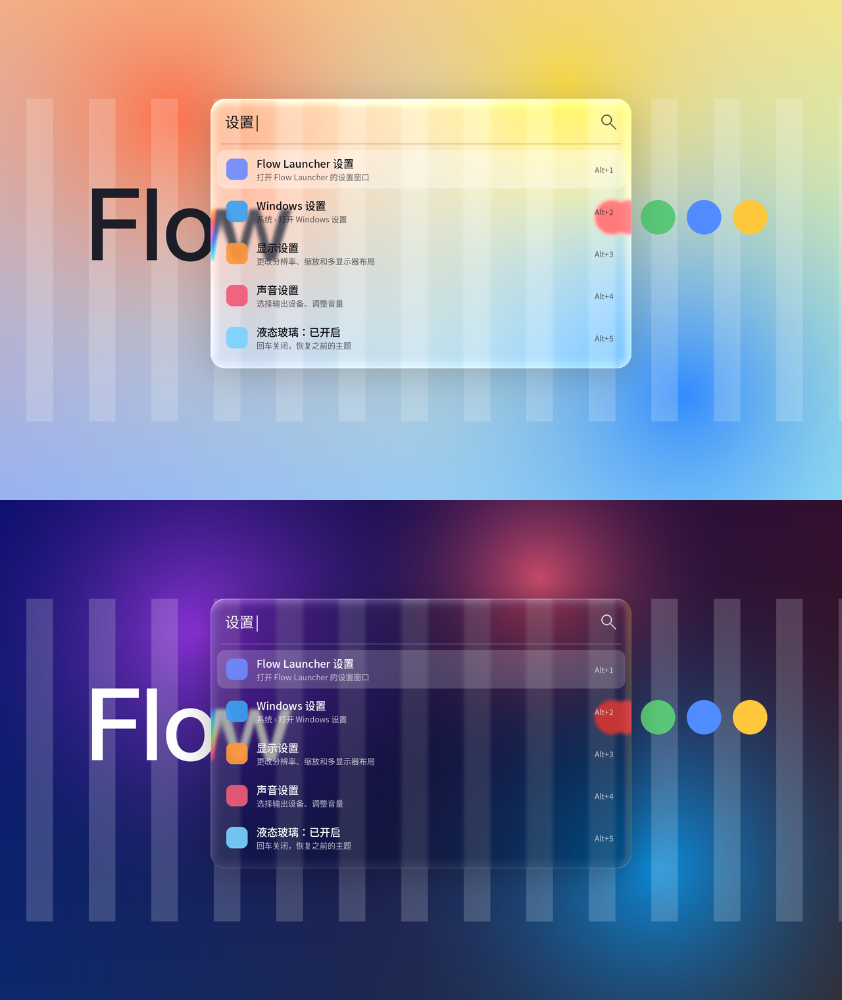

# Flow Launcher · Liquid Glass

English | [简体中文](README.zh-CN.md)

Turns the Flow Launcher main window into "liquid glass": whatever is behind the window bends at the edges like a convex lens, with slight chromatic dispersion and a highlight rim that follows a configurable light angle.



> The preview was rendered offline with the same shader algorithm the plugin uses. The real result on Windows may differ slightly.

## How it works

Flow's C# plugins run inside the main process and can reach the main window and the theme API directly, so the plugin does two things:

1. **Generates and applies a theme**: writes `Liquid Glass.xaml` (text colors, corner radius, translucent selection) to `%APPDATA%\FlowLauncher\Themes\` and switches to it with `IPublicAPI.SetCurrentTheme`.
2. **Injects a glass layer**: wraps the main window's content in a Grid and places a rectangle with a pixel shader underneath the original `WindowBorder`:
   - `SetWindowDisplayAffinity(WDA_EXCLUDEFROMCAPTURE)` hides the Flow window from screen capture, so GDI can grab the area behind it;
   - the capture is downscaled and blurred with three box-blur passes to get a frosted base;
   - an HLSL shader (compiled at runtime with the system's `d3dcompiler_47.dll`, no precompiled files needed) uses the signed distance field of a rounded rectangle to compute edge normals, then applies refraction offset, RGB-split dispersion, saturation/tint adjustment and the highlight.

The background is captured once, synchronously, when the window is shown (before the first frame is rendered). Moving the window or changing its height only updates the texture mapping, without capturing again. The optional "live refresh" re-captures at an interval while the window is visible (on a background thread).

## Two modes

| | Refraction (default) | System acrylic |
|---|---|---|
| Background | Plugin screen capture + shader | Windows 11 DWM Acrylic |
| Refraction / dispersion | Yes | No |
| Highlight rim | Yes | Yes (on top of the DWM backdrop) |
| Requirements | Windows 10 2004+ | Windows 11 |
| Side effect | The Flow window does not appear in screenshots, recordings or screen sharing | None |

## Install

From the Flow Launcher plugin store (once approved), or manually: download `Flow.Launcher.Plugin.LiquidGlass.zip` from [Releases](https://github.com/NblScript/Flow.Launcher.Plugin.LiquidGlass/releases), unzip it into

```
%APPDATA%\FlowLauncher\Plugins\LiquidGlass\
```

and restart Flow Launcher. Requires Flow Launcher 2.0.0 or later. On first load the plugin switches to the "Liquid Glass" theme automatically.

## Build

Requires the .NET 9 SDK on Windows.

```powershell
dotnet build Flow.Launcher.Plugin.LiquidGlass.csproj -c Release -o out
```

Copy `Flow.Launcher.Plugin.LiquidGlass.dll`, `plugin.json` and the `Images` folder from `out` into the plugin folder above. The GitHub Actions workflow in `.github/workflows/build.yml` builds on a Windows runner and produces a ready-to-install zip.

## Usage

Type `glass` in Flow:

- **On / off**: toggles the effect; turning it off restores the theme you used before
- **Mode**: switches between refraction and system acrylic
- **Appearance**: follow Flow / light / dark
- **Adjust settings…**: opens Flow settings → Plugins → Liquid Glass, where you can tune corner radius, blur, refraction strength, edge width, dispersion, tint, saturation, highlight, light angle and the live refresh interval

Labels are shown in English, or in Chinese when Flow's language is set to Chinese.

If you manually switch to another theme in Flow settings, the plugin disables itself and will not take the theme back. Type `glass` and press Enter to turn it on again.

## Flow Launcher 2.x compatibility

The generated `Liquid Glass.xaml` previously referenced `BaseHorizontalScrollBarStyle` and `BaseHorizontalThumbStyle`. These horizontal scrollbar base styles are not present in Flow Launcher 2.0.0–2.1.4, so WPF could reject the entire theme with a `XamlParseException`. The generated theme now omits the unused horizontal scrollbar overrides and retains the existing vertical scrollbar styles.

The generated clock/date panel previously inherited `BaseClockPanel` (a horizontal StackPanel), rather than the regular `ClockPanel` (vertical). With both options enabled, the time and date were rendered next to each other without a gap. The theme now preserves the native vertical layout, the clock/date styles, and Flow Launcher's independent visibility settings. When only one is enabled, there is no reserved space for the other.

The build workflow includes a static compatibility regression check against the shared `Base.xaml` resource keys from Flow Launcher 2.0.0, 2.1.0 and 2.1.4, as well as clock/date style invariants. Runtime and visual behavior should also be smoke-tested on Windows, including clock only, date only, both, and neither.

## Known limitations

- Refraction mode uses a snapshot of the background taken when the window opens. If a video is playing behind it, enable "live refresh" (costs some CPU).
- If the GPU does not support Pixel Shader 3.0, or WPF is in software rendering, the plugin falls back to "blurred background + tint + gradient rim" without refraction.
- The glass layer is injected by replacing the main window's `Content`, which relies on the root element of Flow's main window being a `Border` (true for 2.x). If a future Flow version changes that structure, the plugin detects it and skips the injection (only the theme is kept).
