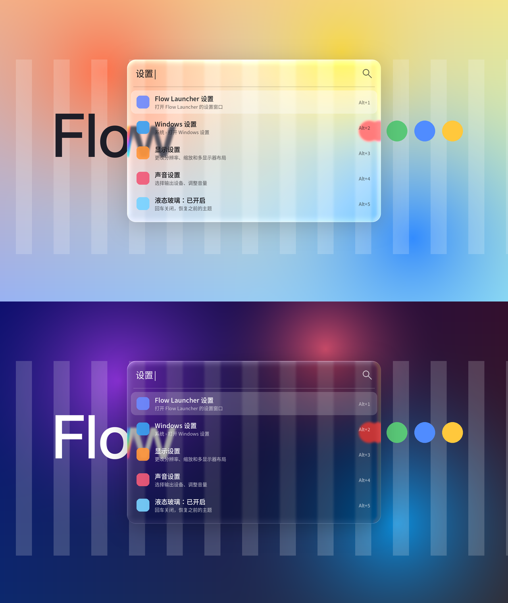

# Flow Launcher · Liquid Glass 插件

[English](README.md) | 简体中文

把 Flow Launcher 的主窗口变成「液态玻璃」：窗口背后的画面在边缘处像凸透镜一样折射弯曲，带轻微色散，四周有随光源角度变化的高光边。



> 预览图是用插件里同一套着色器算法离线渲染的，实际效果以 Windows 上运行为准。

## 原理

Flow 的 C# 插件运行在主进程里，能直接访问主窗口和主题 API，所以插件做了两件事：

1. **生成并切换主题**：往 `%APPDATA%\FlowLauncher\Themes\` 写入 `Liquid Glass.xaml`（文字颜色、圆角、半透明选中态），再通过 `IPublicAPI.SetCurrentTheme` 切过去。
2. **注入玻璃层**：把主窗口的内容包进一个 Grid，在原 `WindowBorder` 下面垫一层带像素着色器的矩形：
   - 用 `SetWindowDisplayAffinity(WDA_EXCLUDEFROMCAPTURE)` 让 Flow 窗口不出现在屏幕捕获里，然后 GDI 抓取窗口背后的区域；
   - 缩小 + 三次盒式模糊得到毛玻璃底；
   - HLSL 着色器（运行时用系统自带的 `d3dcompiler_47.dll` 编译，不需要预编译文件）根据圆角矩形的 SDF 计算边缘法线，做折射位移、RGB 分离色散、饱和度/着色调整和高光。

窗口显示时同步抓一次背景（在首帧渲染之前），窗口移动或变高时只更新纹理映射，不重复抓屏。可选「实时刷新」在窗口显示期间按间隔重新抓取（后台线程）。

## 两种模式

| | 自绘折射（默认） | 系统亚克力 |
|---|---|---|
| 背景 | 插件抓屏 + 着色器 | Win11 DWM Acrylic |
| 折射 / 色散 | 有 | 无 |
| 高光边 | 有 | 有（叠加在 DWM 背景上） |
| 系统要求 | Win10 2004+ | Win11 |
| 副作用 | Flow 窗口不会出现在截图/录屏/屏幕共享里 | 无 |

## 构建与安装

需要 .NET 9 SDK（Windows）。最低支持 Flow Launcher 2.0.0。

```powershell
dotnet build Flow.Launcher.Plugin.LiquidGlass.csproj -c Release -o out
```

把 `out` 里的 `Flow.Launcher.Plugin.LiquidGlass.dll`、`plugin.json`、`Images` 文件夹复制到：

```
%APPDATA%\FlowLauncher\Plugins\LiquidGlass\
```

重启 Flow Launcher。首次加载会自动切换到「Liquid Glass」主题。

也可以把这个文件夹推到 GitHub，`.github/workflows/build.yml` 会在 Windows runner 上构建并产出可直接解压安装的 zip。

## 使用

在 Flow 里输入 `glass`：

- **液态玻璃：已开启 / 已关闭** —— 开关；关闭时恢复你之前用的主题
- **模式** —— 在自绘折射和系统亚克力之间切换
- **外观** —— 跟随 Flow / 浅色 / 深色
- **调整参数…** —— 打开 Flow 设置，到「插件 → Liquid Glass」调圆角、模糊、折射强度、边缘宽度、色散、着色、饱和度、高光、光源角度、实时刷新间隔

如果你在 Flow 设置里手动换成别的主题，插件会自动停用，不会再把主题抢回来；输入 `glass` 回车即可重新开启。

## 已知限制

- 自绘折射模式抓的是窗口弹出那一刻的背景快照；背后在播视频时需要打开「实时刷新」（有一定 CPU 开销）。
- 显卡不支持 Pixel Shader 3.0 或 WPF 处于软件渲染时，会自动退化为「模糊背景 + 着色 + 渐变亮边」，没有折射。
- 该插件通过替换主窗口的 `Content` 注入玻璃层，依赖 Flow 主窗口根元素是一个 `Border`（2.x 版本如此）。Flow 未来若调整主窗口结构，插件会检测到并放弃注入（只保留主题）。
